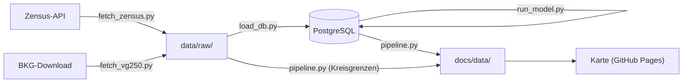

# Nettokaltmieten nach Kreisen (Zensus 2022)

Interaktive Karte der durchschnittlichen Nettokaltmiete je Quadratmeter für alle 400 Kreise und kreisfreien Städte in Deutschland, mit automatisierter Datenpipeline, Qualitätsprüfungen und einem vereinfachten Beispielmodell zur Kappungsgrenze, dessen Szenarien sich auf der Karte umschalten lassen.

**Karte:** https://eskrav.github.io/mietatlas/

Ein kleiner Prototyp, entstanden als Arbeitsprobe: ein Indikator, eine räumliche Ebene, aber mit den Bausteinen, die ein größerer Datenatlas braucht.

## Schnellstart

Voraussetzungen: Python 3.14 und eine laufende PostgreSQL-Datenbank (getestet mit Version 16).

```bash
pip install -r requirements-dev.txt   # Laufzeitpakete und pytest; nur requirements.txt genügt ohne Tests
createdb mietatlas                    # einmalig
python load_db.py                     # Rohdaten prüfen und in PostgreSQL laden
python run_model.py                   # Modelltabellen anlegen und Beispielmodell berechnen
python pipeline.py                    # Daten für die Karte nach docs/data/ schreiben
cd docs && python -m http.server      # dann http://localhost:8000
```

Die Verbindung zur Datenbank kommt aus der Umgebungsvariable `DATABASE_URL`; ohne sie wird `postgresql:///mietatlas` verwendet.

Die Paketversionen sind in `requirements.txt` fest vorgegeben, damit derselbe Code-Stand immer dieselbe Umgebung und dasselbe Ergebnis ergibt; `requirements-dev.txt` ergänzt das Testwerkzeug.

Die Rohdaten sind eingecheckt; neu abrufen muss man sie nur, um sie zu aktualisieren:

```bash
export ZENSUS_API_TOKEN=...
python fetch_zensus.py                # Zensus-Tabelle neu abrufen
python fetch_vg250.py                 # Kreisgrenzen neu abrufen
```

Für `fetch_zensus.py` braucht es ein kostenloses Konto bei der [Zensusdatenbank](https://ergebnisse.zensus2022.de/datenbank/online/). Das API-Token steht nach dem Anmelden unter „Webservice (API)“ und wird als Umgebungsvariable übergeben. Für `fetch_vg250.py` ist kein Konto nötig.

## Aufbau



1. **Abrufen.** `fetch_zensus.py` ruft Tabelle 4000W-0004 auf Kreisebene über die Schnittstelle (API) der Zensusdatenbank ab und entpackt sie. `fetch_vg250.py` lädt das VG250-Archiv (Stand 31.12.2022) vom Downloadserver des BKG und entnimmt nur die Kreisebene. Beide ersetzen die Dateien unter `data/raw/` nur, wenn die neuen Dateien die Prüfungen bestehen; sonst bleibt die bisherige Datei unverändert.
2. **Laden.** `load_db.py` prüft die Zensus-Tabelle mit denselben Prüfungen und lädt sie in eine PostgreSQL-Datenbank.
3. **Rechnen.** `run_model.py` legt die Modelltabellen an und berechnet das Beispielmodell in der Datenbank.
4. **Exportieren.** `pipeline.py` liest die Mietwerte und die veröffentlichten Szenarien aus der Datenbank und die Kreisgrenzen aus `data/raw/vg250/`, prüft alles, verknüpft Werte und Grenzen über den Amtlichen Gemeindeschlüssel (AGS) und schreibt die Daten für die Karte nach `docs/data/`.
5. **Veröffentlichen.** Bei jedem Push auf `main` startet ein GitHub-Actions-Workflow eine temporäre PostgreSQL-Datenbank, führt die Tests aus, lädt die eingecheckten Rohdaten hinein, berechnet das Beispielmodell, führt die Pipeline samt Prüfungen aus und veröffentlicht die Karte nur, wenn alles besteht. Die Datenbank existiert nur während des Laufs.

| Datei | Aufgabe |
|---|---|
| `fetch_zensus.py`, `fetch_vg250.py` | Rohdaten abrufen, prüfen und unter `data/raw/` ablegen |
| `zensus.py` | Zensus-Tabelle lesen und prüfen |
| `checks.py` | gemeinsame Fehlerklasse für Datenprüfungen |
| `load_db.py` | geprüfte Werte in die Datenbank laden |
| `run_model.py` | Modelltabellen anlegen, Beispielmodell berechnen |
| `db.py` | Lesen aus der Datenbank |
| `pipeline.py` | Geometrien, Abgleich, Export für die Karte |
| `db/schema.sql` | Tabellen für Gebiete, Indikatoren, Werte, Quellen und Ladevorgänge |
| `db/model_schema.sql` | Tabellen und Sichten für Parameter, Szenarien, Läufe und Ergebnisse |
| `db/model_kappung.sql` | Modellcode: Funktion für einen Modelllauf |
| `db/kappung_demo.sql` | Parameter, Szenarien und Beispielläufe des Beispielmodells |
| `db/queries.sql`, `db/model_queries.sql` | Beispiel- und Prüfabfragen |
| `tests/` | Tests (siehe [Tests](#tests)) |
| `docs/` | die Karte: `index.html`, erzeugte Daten unter `docs/data/`, Schrift und Kartenbibliothek unter `docs/vendor/` |
| `.github/workflows/build-and-deploy.yml` | Tests, Build und Veröffentlichung |

Der Code ist nach Aufgaben getrennt; Abruf, Laden und Modelllauf kommen dadurch ohne die Geo-Bibliotheken aus.

## Daten

| Quelle | Inhalt | Stand | Lizenz |
|---|---|---|---|
| [Zensus 2022](https://ergebnisse.zensus2022.de), Tabelle 4000W-0004 | Durchschnittliche Nettokaltmiete (€/m²) je Kreis | Stichtag 15.05.2022 | [dl-de/by-2-0](https://www.govdata.de/dl-de/by-2-0), © Statistische Ämter des Bundes und der Länder, Deutschland, 2026 |
| [BKG](https://www.bkg.bund.de), Verwaltungsgebiete 1:250 000 (VG250), Ebene Kreise | Kreisgrenzen | 31.12.2022 | [dl-de/by-2-0](https://www.govdata.de/dl-de/by-2-0), © BKG (2026), [Datenquellen](https://sgx.geodatenzentrum.de/web_public/gdz/datenquellen/datenquellen_vg_nuts.pdf); Daten verändert (Grenzen vereinfacht und umprojiziert) |

Die Rohdaten liegen unverändert unter `data/raw/`.

Wichtig für die Interpretation: Es handelt sich um **Bestandsmieten** aller vermieteten Wohnungen zum Zensusstichtag, nicht um aktuelle Angebotsmieten.

### Prüfungen

Jede Prüfung bricht den Abruf, den Ladevorgang oder den Build mit einer klaren Fehlermeldung ab:

- genau 400 Kreise, eindeutige 5-stellige AGS in beiden Quellen (als Text, damit führende Nullen erhalten bleiben)
- nur bekannte Qualitätskennzeichen, Werte in einem plausiblen Bereich
- nur Landflächen aus VG250 (GF = 4), keine Wasserflächen
- vollständiger Abgleich in beiden Richtungen: kein Kreis ohne Geometrie, keine Geometrie ohne Wert
- für jeden Kreis der Karte ein Wert in jedem veröffentlichten Szenario

Die Grenzen werden mit Coverage-Simplification vereinfacht, damit benachbarte Kreise exakt gemeinsame Grenzen behalten (keine Lücken oder Überlappungen).

## Datenbank

Das Schema steht in `db/schema.sql`:

- `regions`: eine gemeinsame Tabelle für Bund, Länder und Kreise, hierarchisch über `parent_id` verknüpft
- `observations`: eine lange Tabelle mit Wert, Status und Quelle je Gebiet, Indikator und Jahr; weitere Indikatoren oder Jahre kommen als neue Zeilen hinzu, nicht als neue Spalten oder Tabellen
- `indicators` und `sources`: Beschreibung, Einheit, Herkunft und Lizenz
- `data_loads`: ein Protokoll jedes Ladevorgangs mit Zeitpunkt und Prüfsumme (SHA-256) der Rohdatei

Der Ladevorgang läuft in einer einzigen Transaktion und ersetzt die Werte der jeweiligen Quelle vollständig; er lässt sich also beliebig oft wiederholen. Die Rohdaten unter `data/raw/` bleiben dabei unverändert; aus ihnen lässt sich die Datenbank jederzeit neu aufbauen.

`db/queries.sql` enthält Beispielabfragen auf den geladenen Daten: der teuerste Kreis je Land mit seinem Abstand zum Bundeswert, die Spannweite der Mieten innerhalb der Länder und der Anteil der Kreise unter dem Bundeswert (297 von 400, weil der Bundeswert von den großen, teuren Städten geprägt ist). Dazu kommen Prüfabfragen, etwa auf Kreise ohne Wert oder eine falsche Zuordnung zum Land:

```bash
psql -d mietatlas -f db/queries.sql
```

### Wirkungsmodell (Struktur)

`db/model_schema.sql` legt fest, wie sich ein Wirkungsmodell („Maßnahme X → Effekt Y“) in derselben Datenbank ablegen lässt. Es baut auf den Tabellen aus `db/schema.sql` auf:

- `parameters`: jede Modellannahme mit Basiswert, Einheit, Art (politischer Hebel, Definition, empirischer Zusammenhang oder Annahme), Quelle und dem Wertebereich, für den das Modell geprüft ist
- `scenarios` und `scenario_overrides`: Szenarien speichern nur die Parameterwerte, die sie gegenüber der Basis ändern
- `model_runs` und `run_parameters`: jeder Modelllauf mit Modellversion, einem Verweis auf den Ladevorgang, dessen Daten er verwendet hat, und einer Kopie der verwendeten Parameterwerte
- `results`: die Ergebnisse je Lauf, Gebiet und Haushaltstyp; die Sicht `published_results` liefert nur den jeweils neuesten Lauf veröffentlichter Szenarien

So lässt sich jede veröffentlichte Zahl auf Lauf, Modellversion, Rohdatei und Parameterwerte zurückführen, auch wenn sich Annahmen später ändern.

## Beispiel: Kappungsgrenze

> **Ein Demonstrationsmodell, kein realistisches Szenario.** Es zeigt, wie sich ein Wirkungsmodell in der Datenbank ablegen, berechnen und nachvollziehbar auf der Karte darstellen lässt. Echt sind die Ausgangsmieten (Zensus 2022) und die gesetzliche Regel (§ 558 BGB). Frei gewählt sind der Abstand zur Vergleichsmiete, die Abgrenzung angespannter Märkte und die Szenarien; sie sind weder geschätzt noch auf Plausibilität geprüft. Die Ergebnisse hängen stark von diesen Annahmen ab und sagen nichts darüber aus, wie sich Mieten entwickeln oder wie eine Änderung der Kappungsgrenze wirken würde.

### Recht

Die [Kappungsgrenze](https://www.gesetze-im-internet.de/bgb/__558.html) gilt für Mieterhöhungen in bestehenden Mietverhältnissen (§ 558 Abs. 3 BGB): Nach geltendem Recht darf die Miete bei Erhöhungen bis zur ortsüblichen Vergleichsmiete in drei Jahren um höchstens 20 % steigen (Erhöhungen wegen Modernisierung oder Betriebskosten zählen nicht mit). In Gemeinden oder Gemeindeteilen, die das jeweilige Land per Rechtsverordnung als angespannten Wohnungsmarkt bestimmt hat, sind es höchstens 15 %. Die Kappungsgrenze wirkt deshalb vor allem bei Mietverhältnissen, deren Miete deutlich unter der Vergleichsmiete liegt, etwa bei langen Mietverhältnissen ohne Erhöhung.

### Modell

Das Modell betrachtet je Kreis ein Beispiel-Mietverhältnis, das 2022 die Durchschnittsmiete des Kreises zahlt (Ausgangsmiete, Zensus 2022, in €/m²), und rechnet dessen höchstmögliche Miete nach drei Jahren.

Die ortsübliche Vergleichsmiete ist die übliche Miete für vergleichbare Wohnungen in der Gemeinde (§ 558 Abs. 2 BGB), häufig über einen Mietspiegel ermittelt. Für die Kreise liegen dazu keine Daten vor; das Modell nimmt deshalb an, dass sie um einen festen Prozentsatz über der Ausgangsmiete liegt:

> Vergleichsmiete = Ausgangsmiete × (100 % + Abstand zur Vergleichsmiete)

Der Abstand ist also relativ zur Ausgangsmiete gemeint, nicht in Euro: Abstand zur Vergleichsmiete = (Vergleichsmiete − Ausgangsmiete) / Ausgangsmiete.

Für eine Mieterhöhung gelten zwei Grenzen zugleich: Die Miete darf höchstens bis zur ortsüblichen Vergleichsmiete steigen, und sie darf in drei Jahren höchstens um die Kappungsgrenze steigen. Maßgeblich ist die niedrigere der beiden:

> Miete nach drei Jahren = min(Vergleichsmiete, Ausgangsmiete × (100 % + Kappungsgrenze))

Auch die Kappungsgrenze ist ein Prozentsatz der Ausgangsmiete.

Beispiel Berlin: Ausgangsmiete 7,67 €/m², Vergleichsmiete im Modell 20 % darüber (9,20 €/m²), Kappungsgrenze 15 % (8,82 €/m²). Die Kappungsgrenze ist die niedrigere Grenze, die höchstmögliche Miete beträgt also 8,82 €/m².

Als Vergleichswert berechnet jeder Lauf auch die Miete bei durchschnittlicher Mietentwicklung, mit dem Anstieg der Nettokaltmieten im [Verbraucherpreisindex](https://www.destatis.de/DE/Presse/Pressemitteilungen/2025/01/PD25_020_611.html) (2,1 % im Jahr 2024). Bei diesem Tempo greift die Kappungsgrenze nicht; der Wert ist daher in allen Szenarien gleich, was eine eigene Prüfabfrage sicherstellt.

### Szenarien

Neben dem geltenden Recht gibt es zwei frei gewählte Beispielszenarien, die zeigen, dass dieselbe Änderung je nach Ausgestaltung ganz andere Kreise trifft:

| Szenario | angespannte Märkte | übrige Kreise | betroffene Kreise |
|---|---|---|---|
| Geltendes Recht | 15 % | 20 % | – |
| Kappungsgrenze 10 % in angespannten Märkten | 10 % | 20 % | 103 |
| Kappungsgrenze 15 % überall | 15 % | 15 % | 297 |

Die Zahl der betroffenen Kreise folgt aus den gewählten Annahmen, nicht aus Daten: Bei einem Abstand zur Vergleichsmiete von 12 % statt 20 % wäre im Szenario „15 % überall“ kein Kreis betroffen.

### Annahmen

Als Parameter mit Art `assumption` gespeichert und damit änderbar und nachvollziehbar:

- **Abstand zur Vergleichsmiete** 20 %: wie weit die ortsübliche Vergleichsmiete über der Miete liegt, die das Beispiel-Mietverhältnis 2022 zahlt. Der Wert ist nicht geschätzt, sondern so gewählt, dass die Kappungsgrenze im Beispiel greift; bei einem kleineren Abstand blieben Szenarien ohne Wirkung
- **Angespannter Markt**: ein Kreis gilt als angespannt, wenn seine Miete mindestens dem Bundeswert entspricht (103 von 400 Kreisen). Das ist eine Näherung; tatsächlich bestimmen die Länder per Rechtsverordnung einzelne Gemeinden oder Gemeindeteile, nicht ganze Kreise nach ihrem Mietniveau; „geltendes Recht“ im Modell entspricht deshalb nicht überall der tatsächlichen Verordnungslage
- **Musterwohnung** 70 m²: für die Umrechnung in Euro pro Monat. Das Schema unterstützt Haushaltstypen, weil Wirkungsmodelle sie oft brauchen (etwa Energiekosten nach Haushaltstyp); hier hängt die Wirkung je m² aber nicht vom Haushalt ab, deshalb gibt es nur einen Musterhaushalt

### Grenzen des Modells

- Das Hauptergebnis ist eine **Obergrenze für ein Beispiel-Mietverhältnis, keine Prognose**: Es zeigt, wie viel die Miete höchstens steigen darf, nicht, wie viel sie tatsächlich steigt.
- Die gesetzliche Regel gilt für einzelne Mietverhältnisse und deren jeweilige Vergleichsmiete. Das Modell wendet sie auf die Durchschnittsmiete eines ganzen Kreises an; dafür ist sie nicht gemacht, und über einzelne Mietverhältnisse sagt das Ergebnis nichts.
- Die Laufhistorie ist für die Demonstration gestellt: `db/kappung_demo.sql` setzt die Modelltabellen bei jedem Lauf zurück und baut auch die Laufhistorie neu auf, und die Modellversionen sind dort fest eingetragen. In einem echten System würden Läufe nur angehängt und die Version aus dem Code-Stand übernommen.

### Technik

`db/model_kappung.sql` enthält als Modellcode eine Funktion für einen Modelllauf, `db/kappung_demo.sql` die Parameter, Szenarien und Beispielläufe. Eingang sind die echten Kreiswerte aus `observations`; berechnet wird in der Datenbank, je Modelllauf aus den dort gespeicherten Parameterwerten.

Zwei gestellte Fälle zeigen, was das Schema leistet: Ein früherer Lauf mit 15 % Abstand zur Vergleichsmiete zeigt, wie geänderte Annahmen nachvollziehbar bleiben; ein unveröffentlichter Entwurf mit engerer Abgrenzung angespannter Märkte zeigt, dass nur freigegebene Szenarien in `published_results` erscheinen.

`pipeline.py` schreibt die veröffentlichten Szenarien nach `docs/data/szenarien.json`: je Kreis und Szenario die höchstmögliche Miete je m² und pro Monat, die Monatsmiete bei durchschnittlicher Entwicklung sowie die Einstufung des Kreises (angespannt oder nicht), die angewendete Kappungsgrenze und den höchstmöglichen Anstieg, dazu je Szenario Modellversion, Datenstand, Prüfsumme der Rohdatei und die verwendeten Parameterwerte. Fehlt für einen Kreis der Karte ein Szenariowert, bricht der Build ab. Die Karte zeigt diese Werte nur an; sie rechnet nichts davon selbst nach, die Modelllogik liegt allein in der Datenbank.

Abfragen zu Läufen, Parametern und Ergebnissen, dazu die Prüfabfragen des Modells:

```bash
psql -d mietatlas -f db/model_queries.sql
```

## Tests

`tests/` enthält Tests für den Parser (an kleinen Beispieltabellen im Format der Zensus-API), für die Prüfungen, die Farbklassen, die Datenbank, die Modelltabellen, den Export der Szenarien und die Abfragen in `db/queries.sql` und `db/model_queries.sql`: Wiederholtes Laden ergibt denselben Stand, ein fehlgeschlagener Ladevorgang ändert nichts, und die Datenbank liefert genau die Werte der Rohdatei. Die Datenbanktests laufen gegen eine eigene Testdatenbank und werden übersprungen, wenn keine erreichbar ist. Im GitHub-Workflow laufen alle Tests vor jedem Build.

```bash
createdb mietatlas_test   # einmalig, für die Datenbanktests
pytest
```

## Bekannte Grenzen

- **Bundeswert fest im Code.** Der Wert für Deutschland (7,28 €/m²) steht als Konstante in `zensus.py` und wird nicht mit abgerufen.
- **Geometrien außerhalb der Datenbank.** Die Kreisgrenzen liest `pipeline.py` direkt aus den Rohdateien; die Datenbank enthält keine Geometrien (kein PostGIS).
- **Keine Historie der Werte.** Ein neuer Ladevorgang ersetzt die Werte einer Quelle. `data_loads` hält fest, wann welche Rohdatei geladen wurde, frühere Werte bleiben aber nicht in der Datenbank.
- **Kein Gebietsstand.** `regions` bildet nur den Stand vom 31.12.2022 ab; Gebietsänderungen über die Zeit sind nicht vorgesehen.
- **Keine Migrationen.** Die SQL-Dateien legen das Schema an; Änderungen an einem bestehenden Schema werden nicht versioniert.
- **Erzeugte Daten sind eingecheckt.** Der Workflow erzeugt `docs/data/` bei jedem Lauf neu, prüft aber nicht, ob die eingecheckten Dateien dazu passen.
- **Keine automatische Aktualisierung.** Die Rohdaten werden nur neu abgerufen, wenn man die Abrufskripte von Hand startet; es gibt keine regelmäßige Prüfung, ob sich die Quellen geändert haben.
- **Tests nur auf `main`.** Der Workflow läuft nicht auf anderen Branches.
- **Das Modell** ist eine Demonstration; siehe [Grenzen des Modells](#grenzen-des-modells).

## Datenschutz

Die Karte lädt keine Inhalte von Drittanbietern: Schriftart (Fira Sans, SIL Open Font License) und Kartenbibliothek (MapLibre GL JS, BSD-3-Clause) liegen unter `docs/vendor/`, Lizenztexte jeweils dabei. Es gibt keine Cookies und kein Tracking; Impressum und Datenschutzhinweis unter `docs/impressum.html`. Die Seiten sind mit `noindex` für Suchmaschinen gekennzeichnet.

## Entstehung

Den Code habe ich mit Unterstützung von Claude Code geschrieben; die Entscheidungen zu Datenquellen, Prüfungen und Darstellung habe ich selbst getroffen und die Ergebnisse überprüft.
